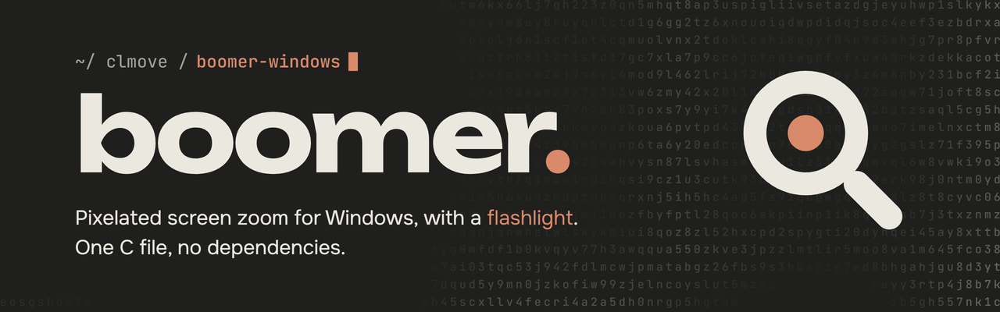
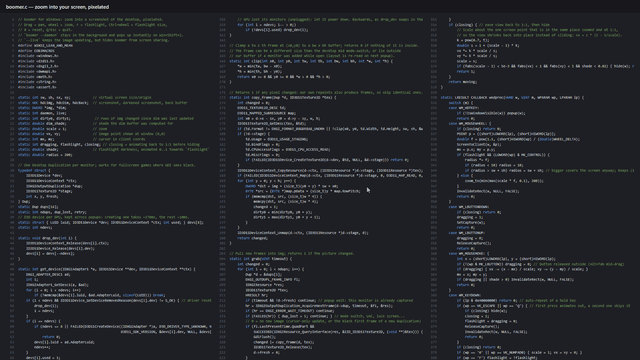

A Windows take on [tsoding/boomer](https://github.com/tsoding/boomer): zoom into your screen, pixelated, with a flashlight.
It's one C file using Win32, GDI and DXGI, with no dependencies, and builds to a ~170 KB exe.



## Build

Needs Visual Studio 2022 with the C++ workload:

```bat
build.bat
```

The exe lands in `build\boomer.exe`.

## Run

```bat
boomer.exe            :: open once, Esc quits
boomer.exe --daemon   :: stay in the background, pop up on Win+Shift+Z
boomer.exe --live     :: keep the image updating while open (combines with --daemon)
```

By default boomer zooms a screenshot taken when it opens, like the original, and shows up in screen sharing (Discord, OBS).
With `--live` the image keeps updating, but boomer has to hide its own window from capture, so viewers of a screen share don't see the zoom.

To start the daemon on login, put a shortcut to `boomer.exe --daemon` into `shell:startup`.

## Controls

| Input | Action |
|---|---|
| Mouse wheel | Zoom toward the cursor |
| Left drag | Pan |
| `F` | Toggle flashlight (fades in/out) |
| Ctrl + wheel | Flashlight radius |
| `0` | Reset view |
| `Q` / `Esc` | Zoom back to 1:1 and close (press again to skip) |

## How it works

- **Capture:** DXGI Desktop Duplication on every monitor, with a GDI fallback. With `--live` the image stays live while open, and boomer's own window is excluded from capture.
- **Pixelated zoom:** `StretchBlt` with `COLORONCOLOR` (nearest neighbour).
- **Monitors:** The layout is re-read on every popup, so plugging monitors in needs no restart.
- **Idle cost:** While hidden, the daemon uses no timer and frees its screen buffers. It keeps the D3D device so popup takes ~20–30 ms.

Known limits: rotated monitors fall back to a static GDI capture. A monitor added while boomer is open shows up on the next popup. While a screen share with cursor is running, Windows may draw the cursor into the screenshot, so it gets zoomed too.
